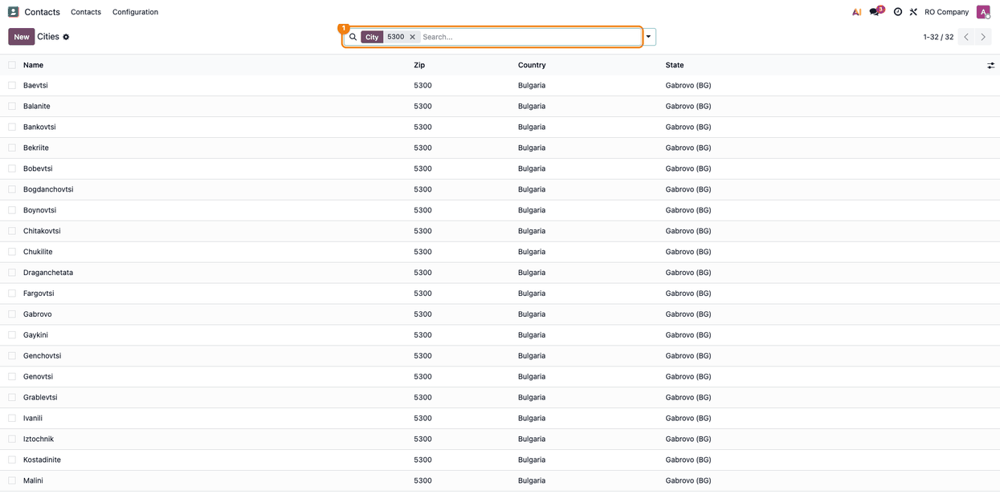
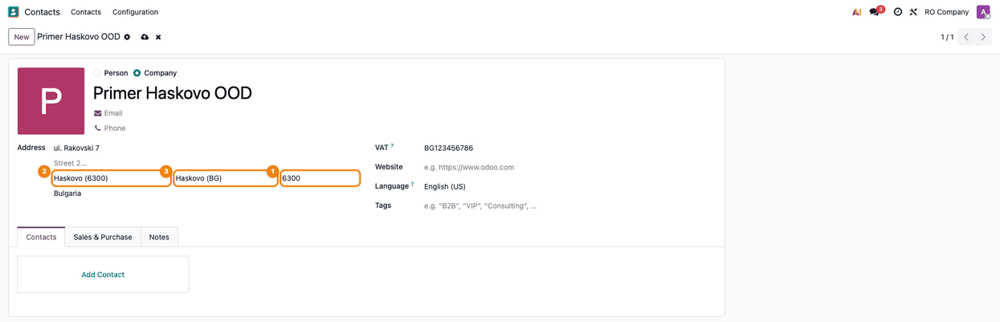
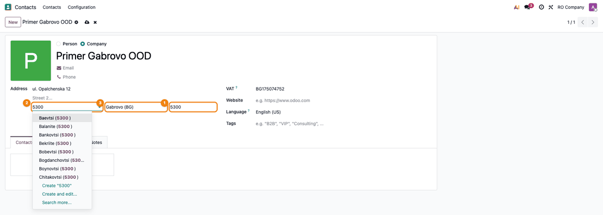
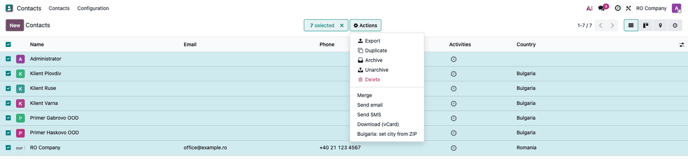
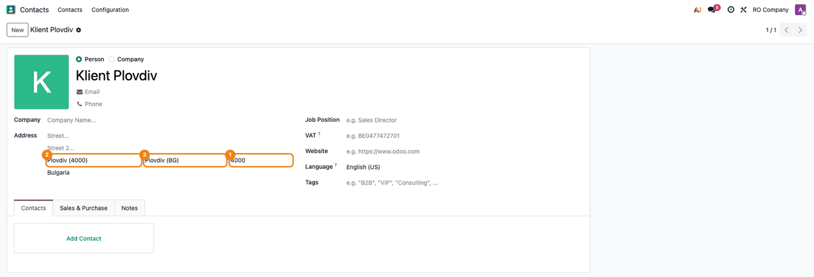

========================
Bulgaria - City from ZIP
========================

..
   !!!!!!!!!!!!!!!!!!!!!!!!!!!!!!!!!!!!!!!!!!!!!!!!!!!!
   !! This file is generated by oca-gen-addon-readme !!
   !! changes will be overwritten.                   !!
   !!!!!!!!!!!!!!!!!!!!!!!!!!!!!!!!!!!!!!!!!!!!!!!!!!!!
   !! source digest: sha256:c0d91c51bb86ea6dda0aa9f4f12579d98e45fb661f9ea8e0ceb8f7123bdd6f68
   !!!!!!!!!!!!!!!!!!!!!!!!!!!!!!!!!!!!!!!!!!!!!!!!!!!!

.. |badge1| image:: https://img.shields.io/badge/maturity-Beta-yellow.png
    :target: https://odoo-community.org/page/development-status
    :alt: Beta
.. |badge2| image:: https://img.shields.io/badge/license-LGPL--3-blue.png
    :target: http://www.gnu.org/licenses/lgpl-3.0-standalone.html
    :alt: License: LGPL-3
.. |badge3| image:: https://img.shields.io/badge/github-dhongu%2Fl10n--bulgaria-lightgray.png?logo=github
    :target: https://github.com/dhongu/l10n-bulgaria/tree/19.0/l10n_bg_zip
    :alt: dhongu/l10n-bulgaria

|badge1| |badge2| |badge3|

Loads the 28 Bulgarian provinces (oblasti) and the Bulgarian localities
with their postal code, and fills in the city and the province of
Bulgarian addresses from the postal code.

- Creates the 28 provinces with their ISO 3166-2:BG code. Provinces
  already entered by hand (in Latin or in Cyrillic, with or without
  "Province") are reused and their duplicates merged, so the database
  does not get a second set.
- Ships the list of Bulgarian localities with their postal code, from
  `GeoNames <https://www.geonames.org>`__ (Creative Commons Attribution
  4.0). The names are in Latin, with the official Bulgarian
  transliteration (Haskovo, Vratsa, Targovishte); the Cyrillic names are
  the Bulgarian translation, shown to the users working in Bulgarian.
- Bulgaria is set to *enforce cities*: the city of a Bulgarian address
  is chosen from the list.
- On the contact form, typing the postal code of a Bulgarian address
  sets the city and the province. A postal code shared by several
  localities sets only the province; the city name, when it matches one
  of them (in Latin or in Cyrillic, without accents and case), picks the
  locality. A "BG-" prefix is dropped.
- The action *Bulgaria: set city from ZIP* on contacts links the
  Bulgarian contacts to the city of their postal code and fills in the
  province.
- At install, the Bulgarian contacts are linked: directly on a small
  database, by the scheduled action *Bulgaria: link contacts to the city
  of their ZIP* in batches on a large one (it deactivates itself when
  done).
- Every form that runs the postal code rules of the contact (for example
  the delivery details of an AWB, with ``deltatech_delivery``) gets the
  city and the province filled in.

**Table of contents**

.. contents::
   :local:

Usage
=====

1. As an administrator, open **Contacts → Configuration → Localization →
   Cities** and search for a postal code: the Bulgarian localities of
   that code are listed with their province.

   |Cities list filtered on the postal code 5300: 32 localities of the
   province Gabrovo (BG)|

2. Open a Bulgarian contact and type the postal code in the address: the
   city and the province are filled in.

   |Contact in Bulgaria: the postal code 6300 fills in the city Haskovo
   (6300) and the state Haskovo (BG)|

3. When the postal code is shared by several localities, only the
   province is filled in; choose the city from the list (type the postal
   code or the name in the city field).

   |Contact in Bulgaria: the postal code 5300 fills in the state Gabrovo
   (BG); the city field lists the localities of 5300|

4. To complete existing or imported contacts, select them in the list
   and run *Actions → Bulgaria: set city from ZIP*.

   |Contacts list with Bulgarian contacts selected and the Actions menu
   open on Bulgaria: set city from ZIP|

   |Contact Klient Plovdiv after the action: ZIP 4000, city Plovdiv
   (4000) and state Plovdiv (BG)|

The localities are named in Latin; with the Bulgarian language
installed, users working in Bulgarian see them in Cyrillic.

Changelog
=========

19.0.1.0.1 (2026-11-04)
-----------------------

**Changed**

- The Cyrillic names of the localities are in the column ``name@bg_BG``
  of ``data/res.city.csv``, loaded by Odoo as the Bulgarian translation;
  ``bg.po`` keeps only the interface strings. The provinces stay in
  Latin: their name is not translatable in Odoo.

19.0.1.0.0 (2026-11-04)
-----------------------

**Added**

- The 28 Bulgarian provinces (ISO 3166-2:BG), reusing the provinces
  already in the database.
- Bulgarian localities with postal code, from GeoNames, named in Latin
  with the Cyrillic names as Bulgarian translation.
- City and province filled in from the postal code on Bulgarian
  addresses; action and scheduled action to link the existing contacts.
- Consultant sheet (readme/FISA_CONSULTANT.md) and screenshots, in
  Romanian and English.

Bug Tracker
===========

Bugs are tracked on `Terrabit Issues <https://www.terrabit.ro/helpdesk>`_.
In case of trouble, please check there if your issue has already been reported.

Do not contact contributors directly about support or help with technical issues.

Credits
=======

Authors
-------

* Terrabit

Maintainers
-----------

.. |maintainer-dhongu| image:: https://github.com/dhongu.png?size=40px
    :target: https://github.com/dhongu
    :alt: dhongu

Current maintainer:

|maintainer-dhongu| 

This module is part of the `dhongu/l10n-bulgaria <https://github.com/dhongu/l10n-bulgaria/tree/19.0/l10n_bg_zip>`_ project on GitHub.

You are welcome to contribute.